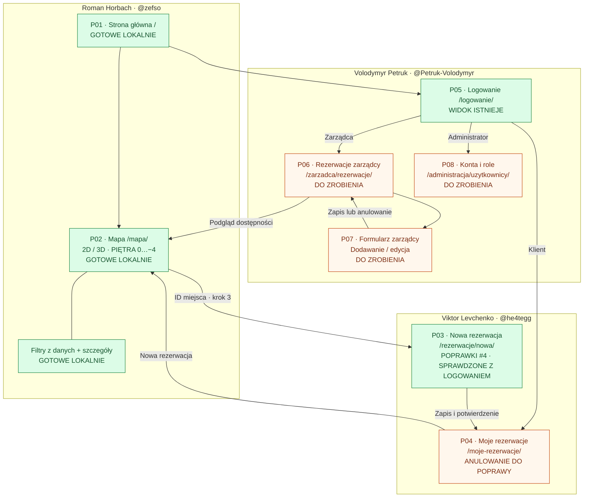

# Mapa stron i podział pracy

Stan lokalnej implementacji: **25.11.2026**. Istnieją adresy `/`, `/mapa/`, `/rezerwacje/nowa/`, `/moje-rezerwacje/`, `/logowanie/`, `/rejestracja/`, POST `/wylogowanie/` oraz API miejsc i rezerwacji. [Integracja z rezerwacjami i wyniki sprawdzenia mapy](integracja-mapy.md).
Panele pracowników nadal są planem. Podział odpowiada F01–F11 w [README](../README.md#funkcjonalności). Zmiany Romana z 25.11 są lokalne; oznaczenie gotowości nie oznacza zamknięcia Issue #4 ani wdrożenia całego projektu.

**Legenda:** GOTOWE LOKALNIE = zakres sprawdzony; DO POPRAWY = istnieje, ale ma blokady; DO ZROBIENIA = brak strony. Statusy podano również tekstowo.

## Schemat

Schemat Mermaid można oglądać bezpośrednio na GitHubie. Strzałki pokazują planowane przejścia użytkownika; wejście do paneli wymaga odpowiedniej roli.

## Lista stron do odhaczania

P01–P08 oznaczają widoki, a F01–F11 funkcje. Jedna strona może realizować kilka funkcji. Formularz P07 ma dwa adresy, ale wspólny szablon.

| Gotowe | ID | Strona i adres | Właściciel | Zakres | Obecny stan |
|---|---|---|---|---|---|
| ☑ | P01 | Główna `/` | Roman | F01: sekcje, nawigacja, menu i mini-mapa | Liczniki z bazy, linki stref, 375 px; gotowe lokalnie |
| ☑ | P02 | Mapa `/mapa/` | Roman | F02–F04: 2D/3D, piętra, filtry, szczegóły | Dane, URL, klawiatura i przekazanie miejsca do formularza sprawdzone |
| ☐ | P03 | Nowa rezerwacja `/rezerwacje/nowa/` | Viktor | F05–F06: pakiet, formularz, wynik zapisu | Poprawki z issue #4; pełna ścieżka z logowaniem sprawdzona 24.11.2026 |
| ☐ | P04 | Moje rezerwacje `/moje-rezerwacje/` | Viktor | F07: lista, anulowanie i link do mapy | Lista istnieje; sprawdzanie właściciela i zwalnianie miejsca do poprawy |
| ☐ | P05 | Logowanie `/logowanie/` | Volodymyr | F08: formularz, błędy, przekierowanie | Widok istnieje, obsługuje next; integracja menu ról pozostaje |
| ☐ | P06 | Panel zarządcy `/zarzadca/rezerwacje/` | Volodymyr | F10: lista, usuwanie, statusy, dostępność | Do zrobienia |
| ☐ | P07 | Formularz `/zarzadca/rezerwacje/nowa/` i `/zarzadca/rezerwacje/<id>/edycja/` | Volodymyr | F10: dodawanie i edycja | Do zrobienia; proponowane adresy |
| ☐ | P08 | Konta `/administracja/uzytkownicy/` | Volodymyr | F11: tworzenie, dezaktywacja, zmiana roli | Do zrobienia |

## Roman — interfejs i mapa

- [x] P01: przygotować podstawową stronę główną i menu mobilne.
- [x] P01: sprawdzić 375 px, menu i odnośniki do nowych stron.
- [x] P01: liczniki z bazy, karty stref z filtrami i mini-mapa powierzchni.
- [x] P02: dodać stronę mapy i pobieranie miejsc przez `fetch`.
- [x] P02: wybór poziomu, sektora i rzędu; legenda statusów.
- [x] P02: połączyć filtry i zapisywać je w URL.
- [x] P02: panel szczegółów i kontrakt przekazania identyfikatora miejsca.
- [x] P02: sprawdzić przekazanie miejsca z powierzchni i podziemia do kroku 3 formularza Viktora; to samo ID i zaznaczenie.
- [x] P02: płaski widok z góry 2D i scena 3D; wspólne współrzędne bez ograniczenia 8 miejsc.
- [x] P02: piętra 0…−4, rozwijany okrągły przełącznik, otoczenie, obsługa klawiatury i ograniczonych animacji.
- [x] P02: opcje stref, sektorów i rzędów z API; nawigacja konta w nagłówku.
- [x] P02: obsłużyć ładowanie, błąd sieci i brak wyników.

## Viktor — ścieżka rezerwacji klienta

- [x] P03: wybór pakietu i odpowiednie pola formularza.
- [x] P03: wejście z mapy zaznacza pakiet „Wybrane miejsce” i miejsce w kroku 3; komunikat, gdy miejsce przestaje pasować.
- [x] P03: link do mapy zachowuje miejsce i filtry; krok 5 pokazuje dane osobowe (PESEL zamaskowany).
- [x] P03: błędy pod polami zamiast dymków przeglądarki; komunikat widoczny na telefonie; plan miejsc bez przewijania w poziomie przy 375 px.
- [x] P03: walidacja, zapis przez `fetch` i komunikat potwierdzenia.
- [x] P03: automatyczny przydział oraz obsługa braku miejsc i konfliktu rezerwacji.
- [x] P04: lista własnych rezerwacji z pakietem, lokalizacją i statusem.
- [x] P04: pusty stan i aktualizacja listy po zapisie.
- [ ] P04: poprawić backend anulowania (właściciel `customer_id`, status `available`) i zgodność tras w testach; okno potwierdzenia i link do mapy już istnieją.
- [x] P03–P04: linki „Moje rezerwacje” i „Zaloguj”/„Wyloguj” w nagłówku.

## Volodymyr — dostęp i panele pracowników

- [ ] P05: formularz logowania, błędy i przekierowanie zgodne z rolą.
- [x] F08: wylogowanie przez POST jest zaimplementowane.
- [ ] F09: sprawdzanie ról na stronach i w API.
- [ ] P06: lista rezerwacji wszystkich klientów oraz usuwanie z potwierdzeniem.
- [ ] P06: aktualizacja dostępności i oznaczanie miejsca jako zajętego.
- [ ] P07: wspólny formularz dodawania i edycji, korzystający z reguł rezerwacji Viktora.
- [ ] P08: tworzenie i dezaktywacja kont oraz nadawanie i odbieranie roli zarządcy.
- [ ] P08: ochrona ostatniego administratora i blokowanie niedozwolonych operacji.

## Co nie wymaga osobnej strony

- Filtry i szczegóły miejsca są częścią mapy P02.
- Pakiety są pierwszym krokiem formularza P03; potwierdzenie może pojawić się po zapisie na P04.
- Tworzenie konta i zmiana roli mogą być formularzami w panelu P08.
- Wylogowanie to przycisk wysyłający POST `/wylogowanie/`, nie osobna strona.
- Role i uprawnienia F09 działają we wszystkich chronionych widokach i API.
- Sekcje „Strefy”, „Jak to działa” i „Kontakt” pozostają na stronie głównej.
- Samodzielna rejestracja została dodana pod `/rejestracja/`. Rzeczywiste płatności pozostają poza zakresem.

## Kolejność i zależności

1. **M1:** Roman przygotowuje mapę, Volodymyr logowanie i role. Przed integracją zespół uzgadnia w Issues strukturę danych miejsca i rezerwacji oraz odpowiedzi API. Viktor może równolegle przygotować formularz na danych przykładowych.
2. **M2:** Viktor łączy mapę z rezerwacją i listą klienta. Volodymyr wykorzystuje tę samą logikę rezerwacji w panelu zarządcy i dodaje zarządzanie kontami.
3. **M3:** każdy sprawdza swoje strony, następnie zespół testuje pełną ścieżkę: logowanie → mapa → rezerwacja → lista klienta → obsługa przez zarządcę.

Równa liczba stron nie oznacza równego nakładu pracy: mapa Romana i formularz Viktora mają rozbudowaną logikę JS, a część widoków Volodymyra korzysta ze wspólnych formularzy i mechanizmów Django.

## Jak aktualizować postęp

Po zakończeniu części pracy odhacz odpowiednie zadanie (`[ ]` → `[x]`). Całą stronę oznacz jako gotową dopiero po spełnieniu kryteriów przypisanych funkcji z README, sprawdzeniu błędów, uprawnień i małego ekranu. Wtedy zmień status w tabeli, w schemacie i w README. Aktualizuj datę stanu oraz dodaj link do odpowiedniego Issue lub commita. Blokady i uzgodnienia zapisuj w GitHub Issues.
