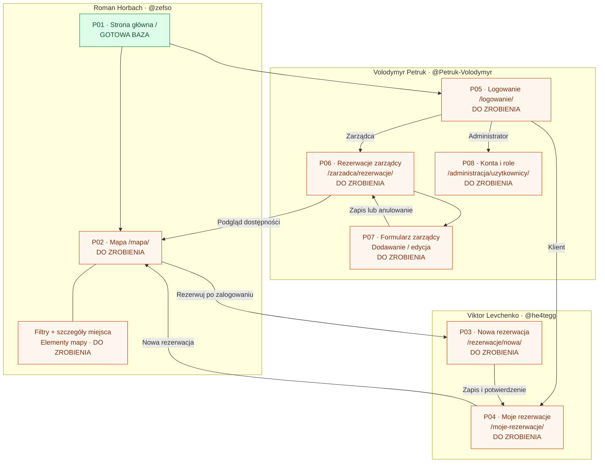

# Mapa stron i podział pracy

Stan sprawdzony w kodzie: **27.10.2026**. Obecnie istnieje tylko adres `/`.
Pozostałe adresy to plan, a nie działające linki. Podział odpowiada funkcjom F01–F11 w [README](../README.md#funkcjonalności).

**Legenda:** GOTOWA BAZA = strona istnieje, wymaga końcowej weryfikacji; DO ZROBIENIA = brak strony. Kolory są dodatkowym oznaczeniem, status podano również tekstowo.

## Schemat

Schemat Mermaid można oglądać bezpośrednio na GitHubie. Strzałki pokazują planowane przejścia użytkownika; wejście do paneli wymaga odpowiedniej roli.

## Lista stron do odhaczania

P01–P08 oznaczają widoki, a F01–F11 funkcje. Jedna strona może realizować kilka funkcji. Formularz P07 ma dwa adresy, ale wspólny szablon.

| Gotowe | ID | Strona i adres | Właściciel | Zakres | Obecny stan |
|---|---|---|---|---|---|
| ☐ | P01 | Główna `/` | Roman | F01: sekcje, nawigacja, menu mobilne | Baza działa; końcowa kontrola dostępności i responsywności |
| ☐ | P02 | Mapa `/mapa/` | Roman | F02–F04: mapa, filtry, szczegóły | Brak strony; na głównej jest dekoracyjna makieta |
| ☐ | P03 | Nowa rezerwacja `/rezerwacje/nowa/` | Viktor | F05–F06: pakiet, formularz, wynik zapisu | Do zrobienia |
| ☐ | P04 | Moje rezerwacje `/moje-rezerwacje/` | Viktor | F07: lista i szczegóły własnych rezerwacji | Do zrobienia |
| ☐ | P05 | Logowanie `/logowanie/` | Volodymyr | F08: formularz, błędy, przekierowanie | Brak strony; konfiguracja auth i sessions przygotowana |
| ☐ | P06 | Panel zarządcy `/zarzadca/rezerwacje/` | Volodymyr | F10: lista, usuwanie, statusy, dostępność | Do zrobienia |
| ☐ | P07 | Formularz `/zarzadca/rezerwacje/nowa/` i `/zarzadca/rezerwacje/<id>/edycja/` | Volodymyr | F10: dodawanie i edycja | Do zrobienia; proponowane adresy |
| ☐ | P08 | Konta `/administracja/uzytkownicy/` | Volodymyr | F11: tworzenie, dezaktywacja, zmiana roli | Do zrobienia |

## Roman — interfejs i mapa

- [x] P01: przygotować podstawową stronę główną i menu mobilne.
- [ ] P01: sprawdzić mały ekran, klawiaturę i odnośniki do nowych stron.
- [ ] P02: dodać stronę mapy i pobieranie miejsc przez `fetch`.
- [ ] P02: wybór poziomu, sektora i rzędu; legenda statusów.
- [ ] P02: połączyć filtry i zapisywać je w URL.
- [ ] P02: panel szczegółów i przejście do rezerwacji z identyfikatorem miejsca.
- [ ] P02: obsłużyć ładowanie, błąd sieci i brak wyników.

## Viktor — ścieżka rezerwacji klienta

- [ ] P03: wybór pakietu i odpowiednie pola formularza.
- [ ] P03: przejąć miejsce wybrane na mapie i sprawdzić zgodność z pakietem.
- [ ] P03: walidacja, zapis przez `fetch` i komunikat potwierdzenia.
- [ ] P03: automatyczny przydział oraz obsługa braku miejsc i konfliktu rezerwacji.
- [ ] P04: lista własnych rezerwacji z pakietem, lokalizacją i statusem.
- [ ] P04: pusty stan i aktualizacja listy po zapisie.

## Volodymyr — dostęp i panele pracowników

- [ ] P05: formularz logowania, błędy i przekierowanie zgodne z rolą.
- [ ] F08: wylogowanie przez POST i zakończenie sesji.
- [ ] F09: sprawdzanie ról na stronach i w API.
- [ ] P06: lista rezerwacji wszystkich klientów oraz usuwanie z potwierdzeniem.
- [ ] P06: aktualizacja dostępności i oznaczanie miejsca jako zajętego.
- [ ] P07: wspólny formularz dodawania i edycji, korzystający z reguł rezerwacji Viktora.
- [ ] P08: tworzenie i dezaktywacja kont oraz nadawanie i odbieranie roli zarządcy.
- [ ] P08: ochrona ostatniego administratora i blokowanie niedozwolonych operacji.

## Co nie wymaga osobnej strony

- Filtry i szczegóły miejsca są częścią mapy P02.
- Pakiety są pierwszym krokiem formularza P03; potwierdzenie może pojawić się po zapisie na P04.
- Tworzenie konta i zmiana roli mogą być formularzami w panelu P08.
- Wylogowanie to przycisk wysyłający POST `/wylogowanie/`, nie osobna strona.
- Role i uprawnienia F09 działają we wszystkich chronionych widokach i API.
- Sekcje „Poziomy”, „Jak to działa” i „Kontakt” pozostają na stronie głównej.
- Samodzielna rejestracja i rzeczywiste płatności nie należą do obecnego planu.

## Kolejność i zależności

1. **M1:** Roman przygotowuje mapę, Volodymyr logowanie i role. Przed integracją zespół uzgadnia w Issues strukturę danych miejsca i rezerwacji oraz odpowiedzi API. Viktor może równolegle przygotować formularz na danych przykładowych.
2. **M2:** Viktor łączy mapę z rezerwacją i listą klienta. Volodymyr wykorzystuje tę samą logikę rezerwacji w panelu zarządcy i dodaje zarządzanie kontami.
3. **M3:** każdy sprawdza swoje strony, następnie zespół testuje pełną ścieżkę: logowanie → mapa → rezerwacja → lista klienta → obsługa przez zarządcę.

Równa liczba stron nie oznacza równego nakładu pracy: mapa Romana i formularz Viktora mają rozbudowaną logikę JS, a część widoków Volodymyra korzysta ze wspólnych formularzy i mechanizmów Django.

## Jak aktualizować postęp

Po zakończeniu części pracy odhacz odpowiednie zadanie (`[ ]` → `[x]`). Całą stronę oznacz jako gotową dopiero po spełnieniu kryteriów przypisanych funkcji z README, sprawdzeniu błędów, uprawnień i małego ekranu. Wtedy zmień status w tabeli, w schemacie i w README. Aktualizuj datę stanu oraz dodaj link do odpowiedniego Issue lub commita. Blokady i uzgodnienia zapisuj w GitHub Issues.
